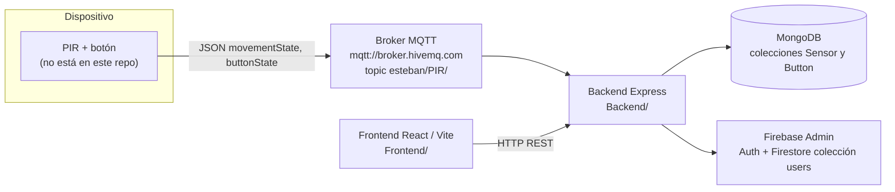

# SMTR / RTLS

Sistema de monitoreo en tiempo real orientado a quirófanos. El repositorio implementa un prototipo IoT: un publicador externo (no incluido aquí) envía el estado de un sensor de movimiento PIR y de un botón; un backend Node los guarda y un panel web muestra ocupación, historial y una pantalla de emergencia.

El nombre en la interfaz y en el pie de página es **RTLS** (*Real-Time Location System*, 2024). En este documento se usa también **SMTR** para el mismo proyecto.

> Los textos de producto (misión, beneficios, privacidad) viven en la página About y en el inicio. Describen la intención del prototipo. Este README no afirma hospitales, usuarios, despliegues ni resultados: no hay evidencia de eso en el código ni en los commits.

## Problema

La página de inicio plantea la optimización del uso de quirófanos mediante el monitoreo de movimiento. La página About concreta esa idea: recoger presencia y actividad dentro del quirófano con sensores e IoT, y mostrarla para apoyar la programación y la gestión.

En el código, esa idea se reduce a dos señales booleanas:

- `movement`: hay movimiento o no (`colección Sensor`).
- `state` del botón: la interfaz lo trata como botón de emergencia. Si el último estado es `true`, se muestra el panel; si es `false`, una pantalla a pantalla completa pide contactar al personal médico.

## Qué hace el sistema

1. Un cliente MQTT publica JSON en el broker público HiveMQ, tópico `esteban/PIR/`. El backend espera `{ movementState, buttonState }`.
2. El suscriptor (`Backend/src/config/sub.js`) guarda cada mensaje en MongoDB: un documento de movimiento y otro del botón, ambos con `date`.
3. La API Express expone consulta, altas manuales, edición, borrado, agregados por intervalos de 5 minutos, promedios horarios, un reporte diario y una ruta de alertas.
4. El frontend React consulta esa API y dibuja series históricas (Chart.js), las dos últimas lecturas (con edición y borrado) y la pantalla de emergencia.
5. El alta de usuarios (`POST /register`) crea el usuario en Firebase Authentication y un documento en Firestore. Las rutas de login y logout están escritas y comentadas; el propio código las marca como experimentales.

Cada muestra suma **20 segundos** de tiempo activo o inactivo (comentario y aritmética en `server-mongo.repository.js` y `fiveminutes.js`). El firmware que debería emitir a ese ritmo **no está en el repositorio**.

### Rutas HTTP

El prefijo sale de `API_VERSION_ROUTE` (en el ejemplo, `/api/v1`).

| Método | Ruta | Uso en el código |
| --- | --- | --- |
| `GET` | `/` | Responde que el servidor está en marcha |
| `GET` | `/sensor/` | Dos últimas lecturas de sensor y de botón |
| `GET` | `/sensors/?page&pageSize` | Histórico de movimiento agregado |
| `GET` | `/button/?page&pageSize` | Histórico del botón agregado |
| `POST` | `/sensor/create` | Alta manual del mismo payload que MQTT |
| `PATCH` | `/sensor/update/:id` | Actualiza un documento de sensor |
| `DELETE` | `/sensor/delete/:id` | Borra un documento de sensor |
| `GET` | `/sensor/date/:date` | Lecturas de un día (`YYYY-MM-DD`) |
| `GET` | `/sensor/report/:date` | Reporte del día (totales e intervalos de 5 minutos) |
| `GET` | `/sensor/stats/:startDate/:endDate` | Estadísticas (la implementación actual no usa el rango) |
| `GET` | `/sensor/alerts` | Alerta de inactividad |
| `PATCH` | `/sensor/button/:id` | Actualiza un documento de botón |
| `DELETE` | `/sensor/button/:id` | Borra un documento de botón |
| `GET` | `/users` | Correos en Firestore |
| `GET` | `/user/:email` | Un usuario |
| `PUT` | `/user/:email` | Actualiza Auth y Firestore |
| `DELETE` | `/user/:email` | Borra el documento y el usuario de Auth |
| `POST` | `/register` | Alta en Firebase Auth + Firestore |

## Arquitectura



El broker, el tópico y el formato del mensaje están fijos en el código. No hay autenticación MQTT.

## Stack

| Capa | Tecnología | Evidencia |
| --- | --- | --- |
| Frontend | React 18, Vite 5, React Router 6, Tailwind CSS, MUI, Radix/shadcn, Chart.js, FullCalendar, Axios | `Frontend/package.json` |
| Backend | Node.js, Express 4, Mongoose 8, cliente MQTT 5, Firebase Admin 12 | `Backend/package.json` |
| Datos de sensores | MongoDB, colecciones `Sensor` y `Button` | `Backend/src/models/values.model.js` |
| Usuarios | Firebase Authentication + Firestore | `Backend/src/services/user-service.js` |
| Mensajería | MQTT contra el broker público HiveMQ | `Backend/src/config/sub.js` |
| CI | GitHub Actions: instalación, `yarn test` (chequeo de sintaxis), `npm run lint` y `npm run build` | `.github/workflows/ci.yml` |

No hay aplicación móvil ni carpeta de firmware, esquemas de hardware o plataforma embebida en este repositorio.

## Estructura

```text
.
├── Backend/
│   ├── index.js
│   ├── package.json
│   ├── yarn.lock
│   ├── .env.example
│   ├── scripts/syntax-check.js
│   └── src/
│       ├── config/          Express, rutas, MQTT, Mongo, Firebase
│       ├── controllers/
│       ├── services/
│       ├── repositories/    Mongo (sensores) y Firestore (usuarios)
│       ├── models/
│       └── utils/           intervalos de 5 minutos y promedios horarios
├── Frontend/
│   ├── package.json
│   ├── package-lock.json
│   ├── .env.example
│   └── src/
│       ├── pages/           Home, About, Sensor, Button, LastValues,
│       │                    Calendar, Devices, Report, RegisterDevice
│       ├── components/      gráficas, tarjetas, UI
│       ├── router/
│       ├── providers/
│       └── services/        cliente de ejemplo contra escuelajs
├── docker-compose.yml       MongoDB local, sin autenticación
├── package.json             atajos desde la raíz
└── .github/workflows/ci.yml
```

Páginas que hoy son un marcador (solo un título): `Report` y `RegisterDevice`. `Devices` no lee dispositivos del backend: transforma productos de `https://api.escuelajs.co/api/v1/products`. El calendario guarda eventos solo en memoria del navegador.

## Cómo ejecutarlo en local

Requisitos que sí declara el proyecto: Node.js **> 18.17** (`Frontend/README.md`). El CI usa Node 20. El backend se instala con **Yarn 1** (`Backend/yarn.lock`); el frontend con **npm** (`Frontend/package-lock.json`).

### 1. MongoDB

Desde la raíz:

```bash
docker compose up -d
```

Eso publica MongoDB 7 en `127.0.0.1:27017`, sin usuario ni contraseña. Sirve solo para desarrollo local.

### 2. Backend

```bash
cd Backend
cp .env.example .env
# Coloca además fb-config.json (cuenta de servicio de Firebase Admin).
# El archivo está en .gitignore y no forma parte del repositorio.
yarn install
yarn dev
```

Variables que el código lee:

| Variable | Dónde | Ejemplo local |
| --- | --- | --- |
| `PORT` | `server.js` (`process.env.PORT \|\| 3000`) | `4000` |
| `API_VERSION_ROUTE` | prefijo de las rutas | `/api/v1` |
| `NODE_ENV` | si ya vale `production` en el proceso, no se carga el `.env` | `development` |
| `MONGO_DB_URI` | `mongoose.connect` | `mongodb://127.0.0.1:27017/smtr` |

`dotenv` se carga solo cuando `NODE_ENV` del proceso **no** es `production` (`Backend/src/config/server.js`). En local, no exportes `NODE_ENV=production` antes de arrancar si quieres que se lea `Backend/.env`.

Firebase Admin hace `require` de `Backend/fb-config.json` al importar la configuración. Sin ese archivo el proceso no arranca. Genera una cuenta de servicio en tu proyecto de Firebase y guárdala con ese nombre. No la subas a git.

Comprobar el proceso: `GET http://localhost:4000/` responde `The server is running` cuando el puerto del ejemplo está en uso.

### 3. Frontend

```bash
cd Frontend
cp .env.example .env
npm ci
npm run dev
```

Abre `http://localhost:5173`. `VITE_API_URL` tiene que apuntar al prefijo real del backend (`http://localhost:4000/api/v1` con el ejemplo de arriba).

### Atajos en la raíz

Hace falta Yarn 1 en el `PATH` para los scripts del backend.

```bash
yarn --cwd Backend install --frozen-lockfile
npm --prefix Frontend ci
yarn --cwd Backend dev
npm --prefix Frontend run dev
```

O, con el `package.json` de la raíz: `npm run install:backend`, `npm run dev:backend`, `npm run lint:frontend`, `npm run build:frontend`, `npm run test:backend`.

### Comprobaciones

```bash
cd Backend && yarn test          # node --check de los .js del backend
cd Frontend && npm run lint
cd Frontend && npm run build
```

No hay tests de comportamiento. `yarn test` solo valida que los archivos JavaScript parsean.

## Seguridad

- `Backend/.env` llegó a estar versionado. En la rama de este trabajo se deja de trackear y se versiona `Backend/.env.example` solo con nombres y placeholders.
- El archivo sigue en el **historial** de `main` hasta que alguien reescriba la historia (por ejemplo con `git filter-repo`) y haga un push con historia reescrita. Quien tenga credenciales reales en ese archivo debe **rotarlas**. Este cambio no reescribe historia.
- `Backend/fb-config.json` está ignorado. No lo commitees.
- `Backend/src/config/database/firebase/firebaseConfig.js` conserva un bloque comentado con configuración de cliente de Firebase. Conviene revisarlo, rotar lo que siga vigente y quitarlo del código y del historial.
- El suscriptor usa el broker público de HiveMQ y un tópico fijo, sin credenciales. Vale como prototipo. Un entorno real necesita un broker propio y secreto fuera del código.

## English

SMTR / RTLS is a prototype for monitoring operating-room use. An external device (not in this repo) publishes `{ movementState, buttonState }` to the public HiveMQ topic `esteban/PIR/`. An Express service stores those booleans in MongoDB and exposes a small REST API. A React/Vite dashboard charts five-minute activity, shows the latest readings, and switches to a full-screen emergency view when the latest button state is `false`. Users are registered with Firebase Admin (Auth + Firestore); login and logout routes are commented and marked experimental.

Stack: React 18, Vite, Tailwind, MUI, Chart.js, Express, Mongoose, MQTT, Firebase Admin, MongoDB. Run Mongo with `docker compose up -d`, copy `Backend/.env.example` and `Frontend/.env.example`, add a local `Backend/fb-config.json`, then `yarn install && yarn dev` in `Backend` and `npm ci && npm run dev` in `Frontend`. CI installs dependencies, syntax-checks the backend, and lints and builds the frontend.

There is no firmware tree and no evidence here of deployments, hospitals, users, or measured outcomes. `Backend/.env` was tracked; it is untracked going forward, but it remains in git history and any real credentials in it should be rotated. See the Spanish sections above for routes and local setup.
